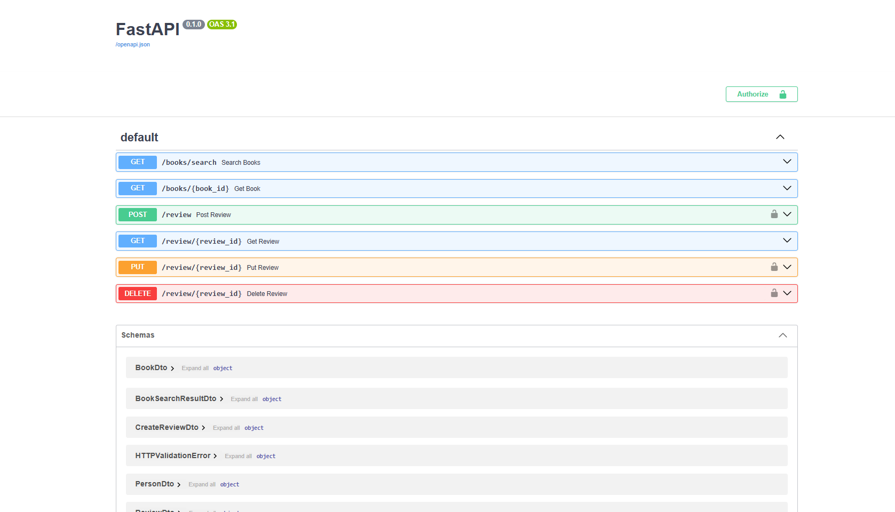

# Your book review service

Develop the following service using a language of your choice between [Go, Python, PHP, ...].
You're free to use any framework and library, but be prepared to have to explain your choices!

Make the service easy to run either using a script, a Dockerfile or writing the commands in a documentation file.
And make sure to write some tests!

## Instructions

We have included a simple compose file to make it easy to run some support services that you could need, but feel free
to change or use something else completely.

To use it you need to have Docker installed, then you can run:

```bash
docker compose up
```

In this project you must use and integrate some calls from a free to use library API.
If you have problems with the ones suggested, use any public API you see fit, even if it's not about books (food,
movies, music... all should allow you to complete all the tasks!).

### APIs

Here is a list of suggested APIs.

- [openlibrary.org](https://openlibrary.org/developers/api) (currently unreachable)
- [gutendex.com](https://gutendex.com)

## Endpoints

### Search books

```http
GET /book/search?q={keywords}
```

- Search on the API, give back the `id` (and whatever seems appropriate) of matches

### Submit review

```http
POST /review
```

```json
{
  "id": "",
  "review": "text",
  "score": 6
}
```

- Validation (check the `id` matches on the API, score range, review characters)
- Save the request to give back a reference for async processing
- Save on DB the complete data (asynchronously, enrich the data via the API with cover image, metadata, etc.)

### Get review and its status

```http
GET /review/{id}
```

Which should follow the following behaviour:

- 202 response code while it's still processing
- 200 response code and your enriched data when everything is ready

### Update review

```http
PUT /review/{id}
```

Allows to update the score and the review content.

### Delete review

```http
DELETE /review/{id}
```

Delete the given review.

## Miscellaneous
Feel free to add everything that's useful or necessary to write high quality code, such as: automatic tests, static code
analysis, coding standards automations, etc.


## How to run

```bash
docker compose up --build
```

- **API**: http://localhost:8000
- **Interactive docs (Swagger)**: http://localhost:8000/docs
- **RabbitMQ management**: http://localhost:15672 (user `user`, password `password`)
- **MariaDB**: `localhost:3306`

## testing

Smoke test with project up


```bash
docker compose run --rm test
```
pytest for unit test and ruff check for code standards and format

```bash
python smoke_test.py
```



## Comments

To develop this project a layered design was implemented with each layer behind an abstract interface. Fast Api routes to handle the incoming requests the validtation logic and the error handling are abstracted away in the controllers module and the logic for search books by id and publish or modified a review lives on service module, as does as the messagin exchange. 
Once the user publishes a review, a ReviewCreated event is creatied with a review id associated to a Review Object with status pending. The user receives a 202 indicating that the review was accepted and is being processed, and when the user later requests the review, the API keeps answering 202 while it is still pending and returns 200 with the review data once processed.
A simple authentication logic using HTTP Basic, where the password is stored as a SHA-256 hash with a random salt and verified with constant time comparision. The reviewer is taken from the credentials instead of the request body, which prevents a user from modifying a review that belongs to a different user.
For messaging, RabbitMQ was implemented using a durable direct exchange that routes the review.created events to a single durable queue with one consumer, the reviewer worker, which runs as a separate process, takes one message at a time and marks the review as processed. Messages are published as persistent and the worker acknowledges them manually, so a message is only removed from the queue once it has been handled. Separating the API from the worker keeps the request fast and allows the processing to be scaled or replaced independently.
A clear interface was defined for every module in order to present a clean architecture and to be able to extend or remove functionalities without affecting the core functionality, for example extending the service to a different book API, another message broker or another database.
Ruff was used to enforce code style and formatting standards, and pytest with pytest-cov was used for unit testing and code coverage. A GitHub Actions CI workflow runs these checks automatically on every push and pull request.